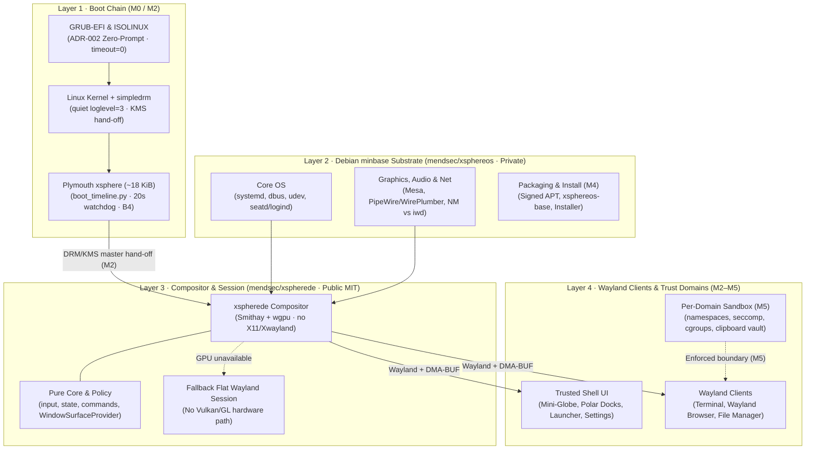
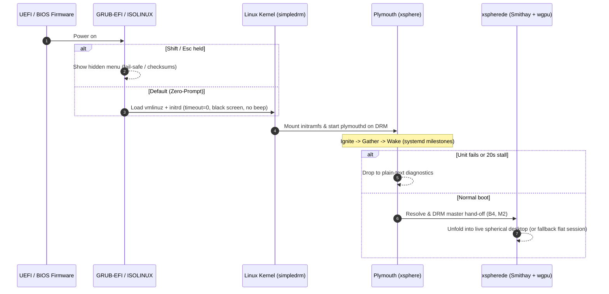
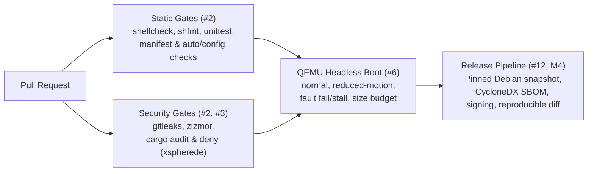

# XSphereOS: System Architecture

High-level architecture and system design for **XSphereOS** (`mendsec/xsphereos`), **XSphereDE** (`mendsec/xspherede`), and their DevSecOps pipeline.

> **Other views in this repository:**
> - **Miro-like editable canvas:** [docs/architecture/xsphereos.excalidraw](architecture/xsphereos.excalidraw) (open in [excalidraw.com](https://excalidraw.com) or the IDE Excalidraw extension).
> - **Offline interactive inspector:** [docs/architecture/index.html](architecture/index.html) (open locally in any browser).

---

## 1. Layered System Architecture

---

## 2. Zero-Prompt Boot & Hand-Off Sequence (ADR-002 & B4)

---

## 3. DevSecOps & Supply Chain Pipeline

---

## 4. Architecture Decision Records

See [docs/adr/README.md](adr/README.md) for accepted and proposed ADRs:
- [ADR-001](adr/ADR-001-github-roadmap-governance.md) — GitHub Roadmap, Governance, and Continuity Structure
- [ADR-002](adr/ADR-002-zero-prompt-bootloaders.md) — Zero-Prompt Direct Boot via `live-build` Bootloader Templates
- [ADR-003](adr/ADR-003-xspherede-visibility.md) — Repository Visibility Policy for `mendsec/xspherede`
- [ADR-004](adr/ADR-004-console-grade-fluidity.md) — Console-Grade Fluidity Discipline (`zstd`, `cgroups v2`, `zram`, `DMA-BUF`)
- [ADR-005](adr/ADR-005-boot-procedural-audio.md) — Boot Procedural Audio (B5) Integration and KVM Boot-Time Measurement
- [ADR-006](adr/ADR-006-installed-performance-and-recovery.md) — Installed System Performance (`host-only` `initramfs`) and Console-Style Recovery
- [ADR-007](adr/ADR-007-m1-kiosk-prototype-session.md) — M1 Prototype Session via Wayland Kiosk (`cage` + `seatd`) and Pinned `xspherede` Build
- ADR-008 (reserved, not yet committed) — Three-Pillar Positioning (Privacy, Security, Old Computers) and Vulnerability-Driven Anti-Pattern Prevention
- [ADR-011](adr/ADR-011-organization-and-product-structure.md) — Organization and Product Structure (Fabrintek, Spheradian, SpheradianOS) After the System76 and Silverblue Models
- [ADR-012](adr/ADR-012-implementation-language-policy.md) — Implementation Language Policy: Rust for What Ships, Scripts for What Builds
- [ADR-014](adr/ADR-014-hardware-targets-and-budgets.md) — Hardware Targets, Reference Machines, and Resource Budgets
- [ADR-015](adr/ADR-015-planisphere-2d-presentation.md) — Planisphere, the 2D Presentation of Spheradian
- [ADR-016](adr/ADR-016-first-usable-build-roadmap.md) — Roadmap Reordering: First Usable Build Before Boot Polish

---

## 5. Technical References & Research

See [docs/REFERENCES.md](REFERENCES.md) for systems research (UFPR Operating Systems Projects, Linux Storage Stack, embedded Wayland micro-compositor frame pacing, SquashFS `zstd` vs `xz` benchmarks, and comparative Privacy, Security, and Old Computers distribution research).
