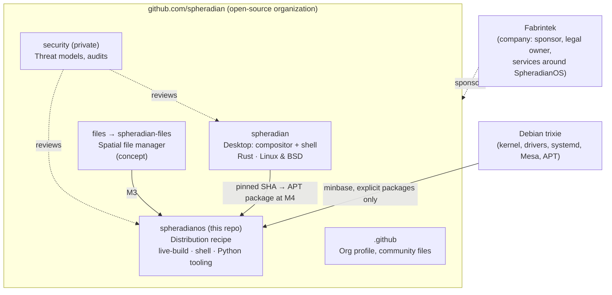

# Spheradian: Organization, Products, and Names

This is the current map of who owns what. The decisions behind it are in [ADR-011](adr/ADR-011-organization-and-product-structure.md) (structure and names) and [ADR-012](adr/ADR-012-implementation-language-policy.md) (languages). When this file and an ADR disagree, the ADR wins. Fix this file.

> **Rename in progress.** The GitHub repositories already use the new names. Most files, identifiers, and documents in this repository still say *XSphereOS* / *XSphereDE* / `xsphere*`, until PR #30 is merged. In this document, the old and new names refer to the same things.

---

## 1. In one paragraph

**SpheradianOS** is an atomic, Debian-based operating system built around **Spheradian**, an original spherical 3D desktop written in Rust. In Spheradian, the interface, the organization of data, the filesystem, and security are one design. The packages (kernel, drivers, systemd, Mesa) come unchanged from Debian. This project's own work is:

- the desktop
- the boot experience and the session
- the **system layer**: immutable image, atomic updates, filesystem layout, memory management
- later, the installer, first boot, and per-domain isolation

**Fabrintek**, the maintainer's company, sponsors the project. The organization and the desktop follow System76 (Pop!_OS and COSMIC). The system layer follows Fedora Silverblue, and on a Debian base, Vanilla OS and Endless OS.

## 2. Ecosystem map

## 3. Repositories

| Repository | Product | Visibility | Language | Ships in SpheradianOS |
|---|---|---|---|---|
| `spheradian/spheradian` | Spheradian desktop | Public | Rust | Yes (pinned build, ADR-007; APT package at M4) |
| `spheradian/files` (to be renamed `spheradian-files`) | Spatial file manager | Public | — (concept, browser demo) | Planned (M3) |
| `spheradian/spheradianos` | SpheradianOS recipe | Private (ADR-010 proposes public after M0) | shell, Python (host only) | It *is* the image |
| `spheradian/security` | Both | Private, always | Docs | No |
| `spheradian/.github` | Organization profile | Public | Markdown | No |
| `fabrintek/*` | Company internals | Private | — | **Never** linked from or mixed with `spheradian` |

Planned repositories (ADR-011 §5.3, ADR-012 §5.4): `spheradian-session` (M2), `spheradian-boot-timeline` (B4), `spheradian-settings` and `spheradian-launcher` (M3), `spheradian-installer` (M4), `spheradian-epoch` (when 3 or more components ship).

## 4. Original or inherited

| Layer | Source | Original? |
|---|---|---|
| Kernel, libc, drivers, firmware, Mesa, systemd, PipeWire | Debian | No, inherited on purpose |
| Image recipe, package curation, boot and fluidity policy | `spheradianos` | Yes: integration and configuration |
| Boot experience (Ignite → Gather → Wake → Resolve → Unfold) | `spheradianos`, then `spheradian` at B4 | Yes: design, timeline, generator |
| Spherical compositor, shell, Mini-Globe, trust-domain policy | `spheradian` | **Yes, the core of the project** |
| System layer: immutable image, atomic updates and rollback, filesystem layout, memory management | `spheradianos` (ADR-013, planned) | **Yes**, the second pillar of original work |
| Session, installer, first boot, settings, audio, sandbox | planned | Yes, all Rust |

## 5. Names

| Use | Spelling |
|---|---|
| Desktop (display) | **Spheradian** |
| Distribution (display) | **SpheradianOS** |
| Desktop crates, packages, binaries, repositories | `spheradian`, `spheradian-<component>` |
| Distribution-level files and packages | `spheradianos-<name>` (for example `spheradianos-base`) |
| Kernel command-line switches | `spheradian.<switch>` (for example `spheradian.motion=reduced`) |
| Company | **Fabrintek**: sponsor line only, never part of a product name |

The name joins *sphere* with *radian*, after the steradian, the unit of solid angle. In November 2026, a web search for "Spheradian" found only results about the steradian, and the GitHub organization belongs to the project. A trademark search has not been done yet (ADR-011 §7, step 7).

## 6. Languages (summary of ADR-012)

| Where the code runs | Language |
|---|---|
| On the user's machine (shipped in the image) | **Rust**. Exceptions: systemd units, initramfs hooks (BusyBox `sh`), the Plymouth script, and short shell glue |
| On the developer's machine or in CI | POSIX shell, Python 3 with the standard library only |
| Used in both places | A Rust crate, used by the host tools through its CLI |

## 7. Open decisions

1. ~~Licence~~ **Decided 2026-11-23: Apache-2.0** for all project code, desktop and recipe (ADR-011 §5.5). Alignment in progress: PR #23 switched to Apache-2.0; `spheradian/files#4` relicenses Files; `spheradian/.github#1` updates the organization profile (merge after `files#4`).
2. Rename `files` → `spheradian-files` (ADR-011 §5.3).
3. Domain and trademark registration under Fabrintek (ADR-011 §7, step 7).
4. Commit the three-pillar positioning ADR (Privacy, Security, Old Computers) as ADR-008.
5. ADR-013, the atomic system layer: image builder and format, update and rollback mechanism, filesystem layout, memory management. It must also settle how this changes `apt` upgrades (`DISTRO-DESIGN.md` §4), the host-only initramfs (ADR-006), and the role of `live-build` (ADR-011 §6).
6. Accept or amend ADR-014 (hardware targets, `arm64`), ADR-015 (Planisphere), and ADR-016 (roadmap); see [PRODUCT-VISION.md](PRODUCT-VISION.md). The three-pillar ADR (item 4) must drop its `amd64`-only exclusion before it is committed.
